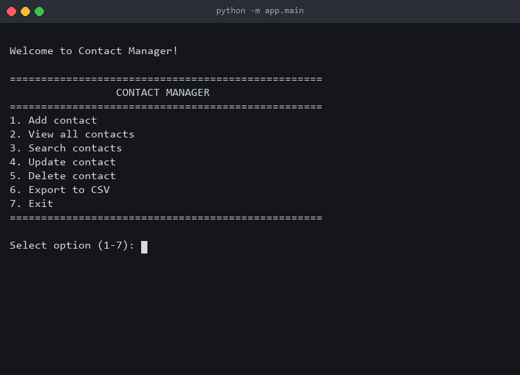
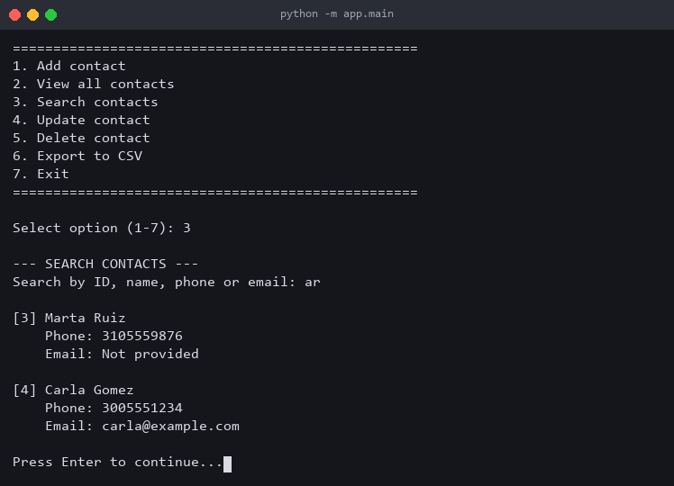
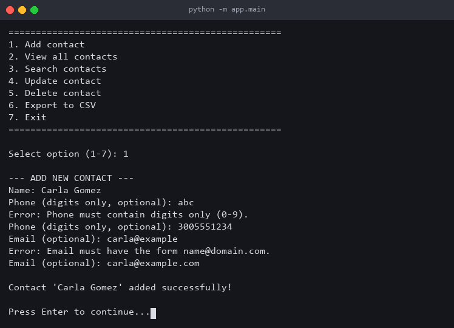
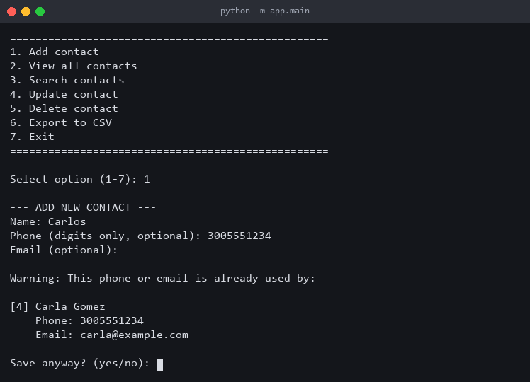
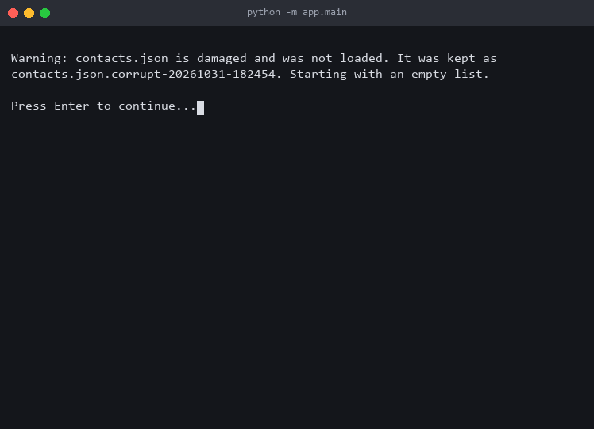
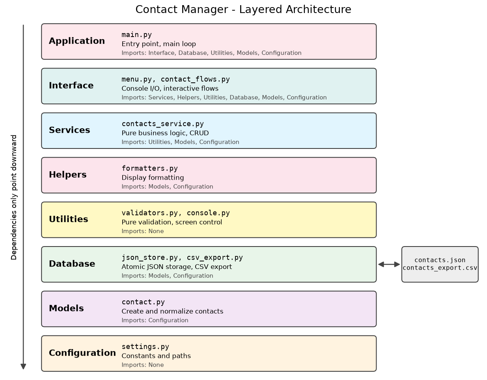

<div align="center">

# Contact Manager CLI

**A fast, dependable contact manager for your terminal.**
Built with pure Python, a clean layered architecture, and storage that protects your data.


[Quick Start](#quick-start) · [Features](#features) · [Screenshots](#screenshots) · [Architecture](#architecture) · [Documentation](#documentation)



</div>

## Quick Start

You only need Python 3.12 or higher. There is nothing else to install.

```bash
git clone https://github.com/SrNe0/contact_manager.git
cd contact_manager
python -m app.main
```

## Features

| Feature | What it does |
|---------|--------------|
| **Contact management** | Add, view, update, and delete contacts, with confirmation before deleting |
| **Flexible search** | Find contacts by exact ID or by part of a name, phone, or email |
| **Input validation** | Checks phone and email formats and asks again when one is invalid |
| **Duplicate warnings** | Asks before saving a phone or email that is already in use |
| **Clear a field** | Enter `-` while updating to remove a phone or email |
| **CSV export** | Writes `contacts_export.csv`, ready to open in a spreadsheet |
| **Safe storage** | Saves atomically and keeps a backup of any damaged file |

## Screenshots

<table>
  <tr>
    <td width="50%" valign="top">
      <strong>Search by any field</strong><br><br>
      
    </td>
    <td width="50%" valign="top">
      <strong>Validation that guides you</strong><br><br>
      
    </td>
  </tr>
  <tr>
    <td width="50%" valign="top">
      <strong>Duplicate warnings</strong><br><br>
      
    </td>
    <td width="50%" valign="top">
      <strong>Damaged files are never lost</strong><br><br>
      
    </td>
  </tr>
</table>

## Your Data Is Protected

Contacts are stored in `contacts.json` in the project root, whichever directory you run the app from. The file is created on the first save and updated after each change.

| Situation | What the app does |
|-----------|-------------------|
| A save fails | Shows the error, undoes the change, and leaves the previous file intact |
| The file is damaged | Keeps it as `contacts.json.corrupt-<timestamp>` and warns you |
| Some records are damaged | Recovers the valid ones and keeps the original as a backup |
| The file cannot be read | Shows the error and closes without touching the file |
| You press Ctrl+C | Exits cleanly; every confirmed change is already saved |

`contacts.json`, its backups, and `contacts_export.csv` hold personal data, so they are excluded from version control.

## Architecture

Each layer has a single responsibility and imports only the layers below it. Business logic never touches the console or files, so it can be tested on its own and reused by another interface.



<details>
<summary><strong>Project structure</strong></summary>

```
contact_manager/
├── app/
│   ├── configs/          # Constants and paths
│   ├── models/           # Contact creation and normalization
│   ├── db/               # JSON persistence and CSV export
│   ├── utils/            # Pure validators and console control
│   ├── helpers/          # Display formatting
│   ├── services/         # Pure business logic (CRUD, search, duplicates)
│   ├── interface/        # Menus and interactive flows
│   └── main.py           # Entry point and main loop
├── docs/                 # Technical documentation, diagram, and images
├── tests/                # Automated tests
├── LICENSE
├── requirements.txt      # Empty: no dependencies
└── README.md
```

</details>

## Running the Tests

The test suite uses the standard library's `unittest`, with temporary files and simulated input.

```bash
python -m unittest discover -s tests -t .
```

## Code Standards

- Functions and dictionaries only, with no classes in the application
- PEP 8, type hints, and a maximum line length of 88 characters
- Google-style docstrings on all public functions
- Tested on Python 3.12 and 3.14

## Documentation

Technical documentation is available in Spanish:

| Document | Contents |
|----------|----------|
| [Requirements](docs/01_requirements.md) | Functional and non-functional requirements, constraints |
| [Architecture](docs/02_architecture.md) | Layers, dependency rules, data flow |
| [Database](docs/03_database.md) | JSON schema, atomic saves, recovery, CSV format |
| [Backend](docs/04_backend.md) | Services, validation rules, error handling, tests |
| [Frontend](docs/05_frontend.md) | Menu flow, screens, and messages |
| [Wireframes](docs/wireframes/main_menu.txt) | ASCII wireframes for every screen |

## License

Released under the [MIT License](LICENSE).
