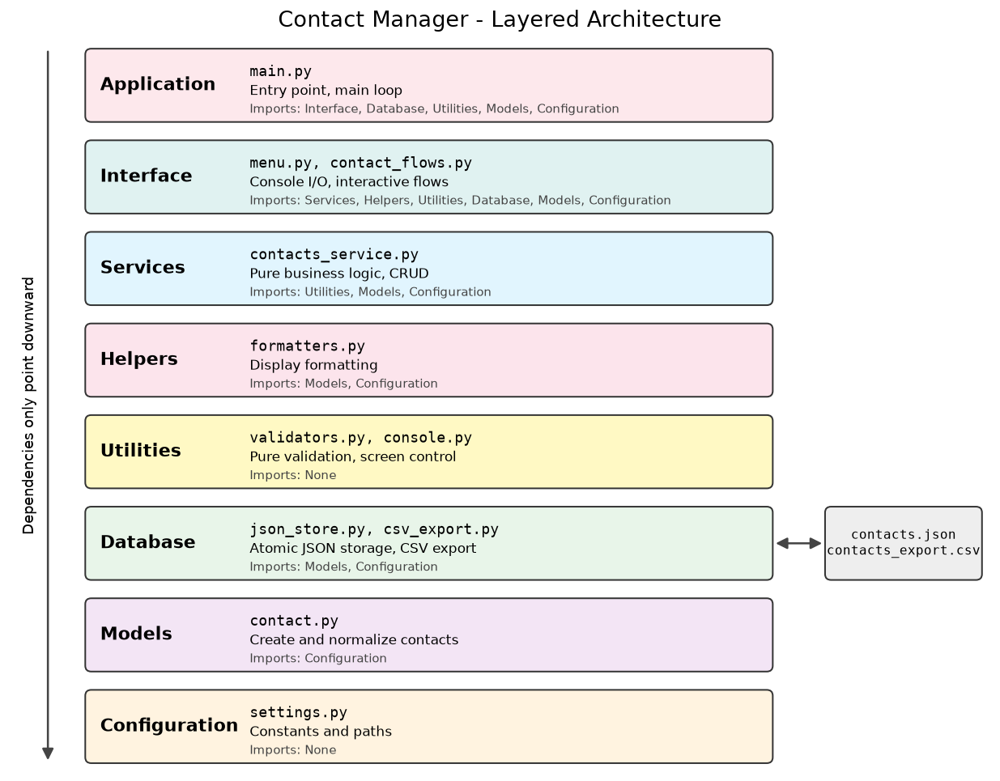
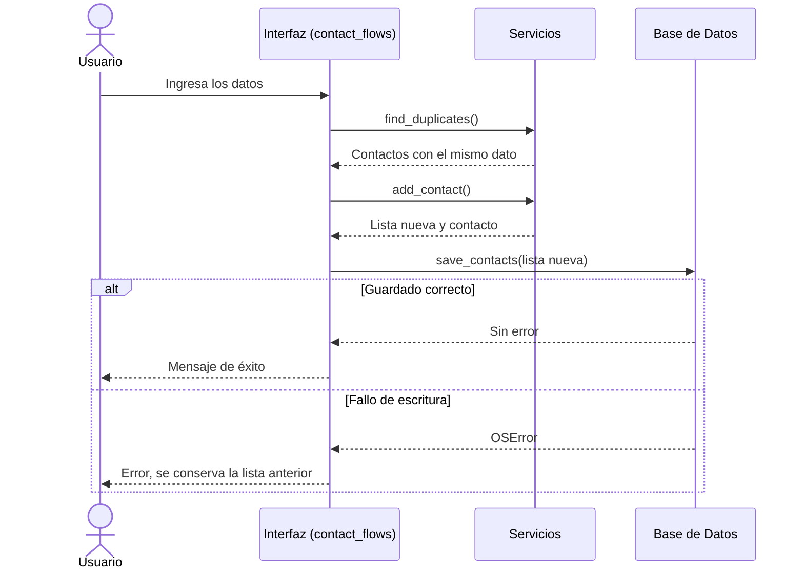
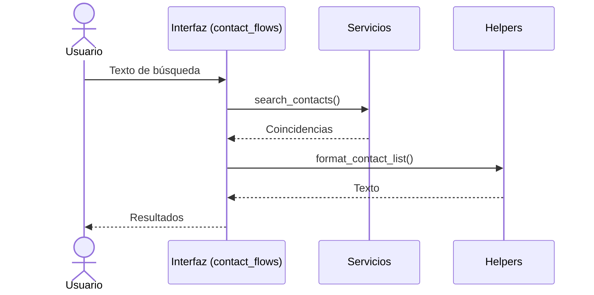

# Documentación de Arquitectura

## 1. Resumen

La aplicación Contact Manager sigue un patrón de **arquitectura en capas** que separa las responsabilidades en capas distintas. Cada capa tiene una responsabilidad específica y solo importa capas inferiores.

Esta arquitectura promueve:
- **Separación de Responsabilidades**: Cada capa maneja un aspecto específico de la aplicación
- **Mantenibilidad**: Los cambios en una capa tienen impacto mínimo en otras
- **Testeabilidad**: La lógica de negocio se prueba sin consola ni archivos
- **Legibilidad**: La organización clara hace que la base de código sea fácil de entender

## 2. Diagrama de Arquitectura

## 3. Descripción de Capas

### 3.1 Capa de Configuración (`app/configs/`)

**Propósito**: Configuración centralizada de la aplicación y constantes.

**Archivos**:
- `settings.py`: Todas las constantes

**Dependencias**: Ninguna

**Constantes Clave**:
- `MENU_WIDTH`: Ancho de la visualización del menú (50 caracteres)
- `MENU_MIN_OPTION`, `MENU_MAX_OPTION`: Rango de opciones válidas del menú (1-7)
- `EXIT_OPTION`: Número de opción del menú para salir (7)
- `NOT_PROVIDED`: Valor predeterminado para campos opcionales
- `CLEAR_FIELD_VALUE`: Valor que vacía un campo opcional al actualizar (`-`)
- `CONFIRM_YES_VALUES`: Entradas de confirmación aceptadas
- `PROJECT_ROOT`: Raíz del proyecto, calculada con `pathlib`
- `JSON_FILE_PATH`, `CSV_EXPORT_PATH`: Rutas absolutas de los archivos de datos

### 3.2 Capa de Modelos (`app/models/`)

**Propósito**: Definiciones de estructura de datos y normalización.

**Archivos**:
- `contact.py`: Alias de tipo `Contact` y funciones de creación y normalización

**Dependencias**: Configuración

**Funciones Clave**:
- `create_contact(contact_id, name, phone, email)`: Crea un diccionario de contacto
- `normalize_contact(raw_contact)`: Completa un registro leído, o retorna `None` si no es recuperable
- `normalize_contacts(raw_contacts)`: Normaliza una lista, repara IDs y cuenta los registros descartados

**Decisión de Diseño**: Usa diccionarios en lugar de clases para cumplir con la restricción R-001.

### 3.3 Capa de Base de Datos (`app/db/`)

**Propósito**: Persistencia, recuperación y exportación de datos.

**Archivos**:
- `json_store.py`: Lectura y guardado atómico del archivo JSON
- `csv_export.py`: Exportación a CSV

**Dependencias**: Modelos, Configuración

**Funciones Clave**:
- `load_contacts(path)`: Retorna `(contactos, advertencia)` y lanza `OSError` si no puede leer
- `save_contacts(contacts, path)`: Guarda de forma atómica y lanza `OSError` si falla
- `export_contacts_csv(contacts, path)`: Escribe el CSV y retorna su ruta

**Principio de Diseño**: Esta capa no imprime nada. Comunica los problemas con valores de retorno y excepciones.

### 3.4 Capa de Utilidades (`app/utils/`)

**Propósito**: Funciones reutilizables sin dependencias.

**Archivos**:
- `console.py`: Limpieza de pantalla
- `validators.py`: Validadores puros

**Dependencias**: Ninguna

**Funciones Clave**:
- `clear_screen()`: Limpia el terminal usando códigos ANSI
- `is_valid_name(name)`, `is_valid_phone(phone)`, `is_valid_email(email)`: Validan un valor
- `parse_contact_id(raw_id)`: Convierte texto en un ID, o retorna `None`

### 3.5 Capa de Helpers (`app/helpers/`)

**Propósito**: Formato de contactos para visualización.

**Archivos**:
- `formatters.py`: Funciones de formato

**Dependencias**: Modelos, Configuración

**Funciones Clave**:
- `format_contact(contact)`: Formatea un contacto individual
- `format_contact_list(contacts)`: Formatea una lista de contactos

### 3.6 Capa de Servicios (`app/services/`)

**Propósito**: Lógica de negocio pura.

**Archivos**:
- `contacts_service.py`: Operaciones CRUD y reglas de negocio

**Dependencias**: Utilidades, Modelos, Configuración

**Funciones Clave**:
- `generate_id(contacts)`: Crea un ID con la estrategia max+1
- `find_contact_by_id(contacts, contact_id)`: Localiza un contacto
- `search_contacts(contacts, query)`: Busca por ID exacto o texto parcial
- `find_duplicates(contacts, phone, email, exclude_id)`: Detecta teléfonos y correos en uso
- `add_contact`, `update_contact`, `delete_contact`: Retornan `(lista_nueva, contacto)`

**Principio de Diseño**: Sin `input`, `print` ni acceso a archivos. Las funciones reciben datos, retornan listas nuevas y señalan errores con `ValueError` y `LookupError`. Por eso se pueden reutilizar desde otra interfaz.

### 3.7 Capa de Interfaz (`app/interface/`)

**Propósito**: Interacción con el usuario y coordinación de cada operación.

**Archivos**:
- `menu.py`: Menú, solicitudes de entrada y mensajes
- `contact_flows.py`: Flujos interactivos que coordinan servicios y persistencia

**Dependencias**: Servicios, Helpers, Utilidades, Base de Datos, Modelos, Configuración

**Funciones Clave de `menu.py`**:
- `show_menu()`, `prompt_menu_option()`: Menú principal
- `prompt_string(message)`, `prompt_contact_id(message)`: Entrada de texto e ID
- `prompt_optional_field(message, is_valid, error_message, allow_clear)`: Entrada opcional validada
- `prompt_confirmation(message)`: Confirmación que retorna un booleano
- `wait_for_enter()`, `print_message(message)`, `print_error(message)`: Salida

**Funciones Clave de `contact_flows.py`**:
- `add_contact_flow`, `view_all_contacts_flow`, `search_contacts_flow`, `update_contact_flow`, `delete_contact_flow`, `export_contacts_flow`

Cada flujo recibe la lista actual y retorna la lista que se debe seguir usando.

### 3.8 Capa de Aplicación (`app/main.py`)

**Propósito**: Punto de entrada de la aplicación y bucle principal.

**Dependencias**: Interfaz, Base de Datos, Utilidades, Modelos, Configuración

**Funciones Clave**:
- `main()`: Carga los datos, maneja Ctrl+C y retorna el código de salida
- `run_menu_loop(contacts)`: Bucle del menú

**Flujo de Control**:
1. Cargar contactos. Si no se pueden leer, mostrar el error y salir con código 1
2. Si hay una advertencia, mostrarla y esperar Enter
3. Bucle:
   - Limpiar pantalla y mostrar el menú (con la bienvenida la primera vez)
   - Obtener opción del usuario
   - Si salir: mostrar despedida y terminar
   - Si inválida: mostrar error y esperar Enter
   - Si válida: ejecutar el flujo y esperar Enter
4. Ctrl+C o fin de la entrada: mostrar despedida y salir con código 0

## 4. Flujo de Datos

### 4.1 Operación de Escritura

### 4.2 Operación de Lectura

## 5. Reglas de Dependencia

1. **Solo Dependencias Descendentes**: Las capas superiores dependen de las inferiores, nunca al revés
2. **Servicios Puros**: Los servicios no conocen la consola ni los archivos
3. **Responsabilidad Única**: Cada módulo tiene una razón para cambiar

## 6. Matriz de Interacción de Capas

| Capa       | Puede Usar                                                |
|------------|-----------------------------------------------------------|
| Main       | Interface, Database, Utils, Models, Config                |
| Interface  | Services, Helpers, Utils, Database, Models, Config        |
| Services   | Utils, Models, Config                                     |
| Helpers    | Models, Config                                            |
| Utils      | Ninguna                                                   |
| Database   | Models, Config                                            |
| Models     | Config                                                    |
| Config     | Ninguna                                                   |

## 7. Patrones de Diseño

### 7.1 Programación Funcional
- No se usan clases en la aplicación
- Las funciones se pasan como valores (`MENU_ACTIONS`, `is_valid`)
- Los diccionarios se usan para estructuras de datos
- Los servicios no modifican las listas que reciben, sino que retornan otras nuevas

### 7.2 Separación de Responsabilidades
- Lógica de UI separada de lógica de negocio
- Lógica de negocio separada de acceso a datos
- Configuración centralizada

### 7.3 Parámetros Explícitos
- Los servicios reciben todos sus datos como parámetros
- La capa de datos acepta la ruta como parámetro, lo que permite probarla con archivos temporales
- Sin estado global (excepto constantes)

## 8. Estrategia de Manejo de Errores

1. **Validación de Entrada**: La interfaz vuelve a solicitar los valores con formato inválido
2. **Reglas de Negocio**: Los servicios lanzan `ValueError` o `LookupError` si reciben datos inválidos
3. **Datos**: La capa de datos conserva los archivos dañados y lanza `OSError` si no puede leer o escribir
4. **Retroalimentación al Usuario**: La interfaz y `main.py` capturan los errores y los muestran

## 9. Puntos de Extensibilidad

1. **Nuevo Backend de Almacenamiento**: Crear `sql_store.py` con las mismas funciones que `json_store.py`
2. **Nueva Interfaz**: Agregar una capa `api/` que use los mismos servicios
3. **Nuevas Validaciones**: Agregar validadores en `utils/validators.py`
4. **Nuevos Campos de Contacto**: Actualizar `models/contact.py`, los servicios y los formatos

## 10. Restricciones de Arquitectura

1. **Sin Clases**: La aplicación usa solo funciones y diccionarios
2. **Solo Biblioteca Estándar**: La aplicación y sus pruebas no tienen dependencias externas
3. **Solo CLI**: Sin interfaz web o GUI
