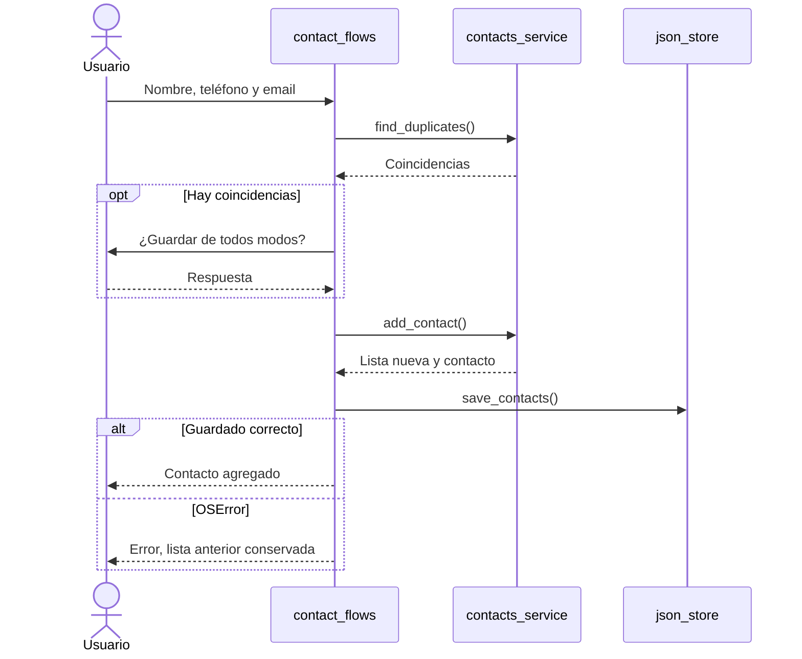
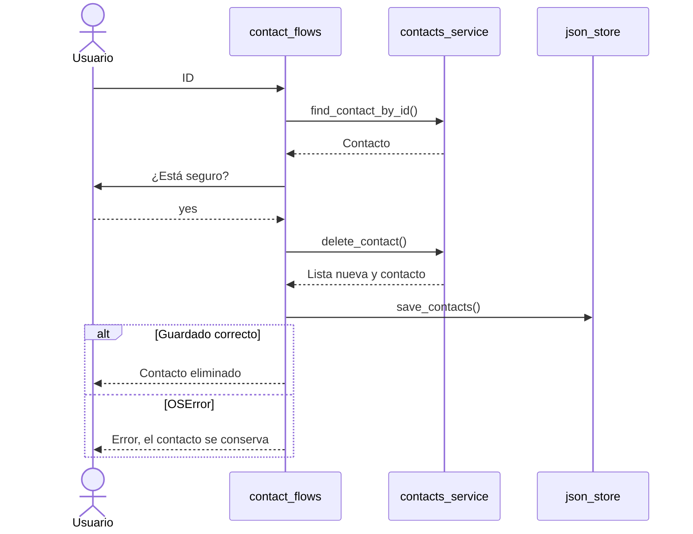
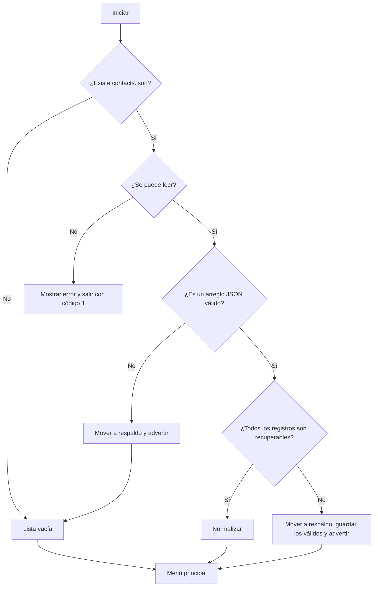

# Documentación de Backend

## 1. Resumen

El backend está formado por **servicios de lógica de negocio puros** que implementan las operaciones CRUD y aplican las reglas de negocio, y por la **capa de datos** que los persiste. Los servicios no leen la consola, no imprimen y no acceden a archivos. Los flujos de `app/interface/contact_flows.py` los conectan con el usuario y con el almacenamiento.

## 2. Arquitectura de la Capa de Servicios

**Ubicación**: `app/services/contacts_service.py`

**Responsabilidades**:
- Implementar las operaciones CRUD y la búsqueda
- Aplicar reglas de validación
- Generar IDs únicos
- Detectar teléfonos y correos en uso

**Convenciones**:
- Las funciones retornan listas nuevas y no modifican las que reciben
- Los datos inválidos lanzan `ValueError`
- Un ID inexistente lanza `LookupError`

Esta forma de trabajar hace que deshacer un cambio sea trivial: si falla el guardado, el flujo sigue usando la lista anterior.

## 3. Funciones de Negocio Principales

### 3.1 Generación de ID

**Función**: `generate_id(contacts)`

```python
def generate_id(contacts):
    return max((contact["id"] for contact in contacts), default=0) + 1
```

**Reglas de Negocio**:
- El primer contacto obtiene ID = 1
- Los IDs subsiguientes son max(existentes) + 1
- Un ID nuevo nunca coincide con el de un contacto existente

**Ejemplo de Secuencia**:
- Inicio: `[]` → ID = 1
- Después de agregar: `[{id:1}, {id:2}]` → siguiente ID = 3
- Después de eliminar ID 1: `[{id:2}]` → siguiente ID = 3
- Después de eliminar ID 2: `[]` → siguiente ID = 1 (se reasigna)

### 3.2 Búsqueda por ID

**Función**: `find_contact_by_id(contacts, contact_id)`

**Retorna**: El contacto si se encuentra, o `None`.

**Complejidad Temporal**: O(n)

### 3.3 Búsqueda por Texto

**Función**: `search_contacts(contacts, query)`

**Reglas**:
- Coincide con el ID exacto, o con parte del nombre, teléfono o email
- No distingue mayúsculas de minúsculas (`casefold`)
- El texto "Not provided" nunca coincide
- Una búsqueda vacía retorna una lista vacía

### 3.4 Detección de Duplicados

**Función**: `find_duplicates(contacts, phone, email, exclude_id)`

**Reglas**:
- Compara el teléfono exacto y el email sin distinguir mayúsculas
- Ignora los valores vacíos
- `exclude_id` omite el contacto que se está actualizando

La detección solo advierte. La decisión de guardar es del usuario, porque dos contactos pueden compartir un teléfono real.

## 4. Operaciones CRUD

### 4.1 Crear Contacto

**Servicio**: `add_contact(contacts, name, phone="", email="")` → `(lista_nueva, contacto)`

**Flujo**: `add_contact_flow(contacts)`

**Historia de Usuario**: Como usuario, quiero agregar un nuevo contacto con nombre, teléfono y correo electrónico.

**Flujo de Trabajo**:
1. Solicitar nombre; si está vacío, mostrar error y volver al menú
2. Solicitar teléfono y email, repitiendo si el formato es inválido
3. Si el teléfono o email están en uso, pedir confirmación
4. Crear el contacto con el servicio
5. Guardar en el archivo JSON
6. Mostrar éxito solo si se guardó

### 4.2 Leer Todos los Contactos

**Flujo**: `view_all_contacts_flow(contacts)`

**Historia de Usuario**: Como usuario, quiero ver todos mis contactos en una lista.

**Formato de Visualización**:
```
[1] John Doe
    Phone: 1234567890
    Email: john@example.com
```

### 4.3 Buscar Contactos

**Servicio**: `search_contacts(contacts, query)`

**Flujo**: `search_contacts_flow(contacts)`

**Historia de Usuario**: Como usuario, quiero encontrar contactos por ID, nombre, teléfono o correo electrónico.

**Casos de Error**:
- Lista vacía → "No contacts available."
- Búsqueda vacía → "Search text cannot be empty."
- Sin coincidencias → "No contacts match '{query}'."

### 4.4 Actualizar Contacto

**Servicio**: `update_contact(contacts, contact_id, name=None, phone=None, email=None)` → `(lista_nueva, contacto)`

**Flujo**: `update_contact_flow(contacts)`

**Historia de Usuario**: Como usuario, quiero actualizar o vaciar la información de un contacto.

**Valores en el Servicio**:

| Valor del parámetro | Efecto |
|---------------------|--------|
| `None` | Mantiene el valor actual |
| `""` en teléfono o email | Vacía el campo ("Not provided") |
| `""` en nombre | `ValueError` |
| Otro valor | Valida y reemplaza |

**Respuestas en la Consola**:

| Respuesta | Efecto |
|-----------|--------|
| Enter | Mantiene el valor actual |
| `-` en teléfono o email | Vacía el campo |
| Otro valor | Valida y reemplaza |

Si no se ingresa ningún cambio, se muestra "No changes made." y no se guarda.

### 4.5 Eliminar Contacto

**Servicio**: `delete_contact(contacts, contact_id)` → `(lista_nueva, contacto_eliminado)`

**Flujo**: `delete_contact_flow(contacts)`

**Historia de Usuario**: Como usuario, quiero eliminar un contacto después de confirmar.

**Lógica de Confirmación**:
- Aceptado: "yes", "y" (insensible a mayúsculas)
- Rechazado: cualquier otra respuesta

### 4.6 Exportar a CSV

**Flujo**: `export_contacts_flow(contacts)`

**Historia de Usuario**: Como usuario, quiero abrir mis contactos en una hoja de cálculo.

Ver el formato en [03_database.md](03_database.md).

## 5. Reglas de Validación

Los validadores están en `app/utils/validators.py`. Son funciones puras: la interfaz los usa para volver a preguntar y los servicios para rechazar datos inválidos.

### 5.1 Validación de Nombre

**Función**: `is_valid_name(name)`

**Regla**: Debe contener caracteres visibles.

**Mensaje de Error**: "Name cannot be empty."

### 5.2 Validación de Teléfono

**Función**: `is_valid_phone(phone)`

**Regla**: Solo dígitos ASCII (0-9). Rechaza dígitos de otros alfabetos, que `str.isdigit()` acepta por sí solo.

```python
def is_valid_phone(phone):
    return phone.isascii() and phone.isdigit()
```

**Mensaje de Error**: "Phone must contain digits only (0-9)."

### 5.3 Validación de Email

**Función**: `is_valid_email(email)`

**Regla**: Forma `nombre@dominio.tld`, sin espacios y con una sola `@`. No comprueba que la dirección exista.

**Mensaje de Error**: "Email must have the form name@domain.com."

### 5.4 Validación de ID

**Función**: `parse_contact_id(raw_id)`

**Regla**: Entero positivo escrito solo con dígitos ASCII. Rechaza `0`, `-1` y `1_2`.

**Mensaje de Error**: "Please enter a positive whole number."

## 6. Estrategia de Manejo de Errores

### 6.1 Errores de Entrada

**Estrategia**: Volver a solicitar con un mensaje claro

- ID, teléfono o email inválido → volver a solicitar
- Nombre vacío al agregar → volver al menú

### 6.2 Errores de No Encontrado

**Estrategia**: Mostrar un mensaje informativo y volver al menú

- ID no encontrado → "Contact with ID {id} not found."
- Lista vacía → "No contacts available."

### 6.3 Errores de Persistencia

| Error | Comportamiento |
|-------|----------------|
| Falla un guardado | Muestra el error, descarta el cambio y no informa éxito |
| Falla la exportación | Muestra el error; los contactos no cambian |
| Archivo dañado al iniciar | Lo conserva como respaldo y advierte antes del menú |
| Archivo ilegible al iniciar | Muestra el error y se cierra con código 1 sin tocar el archivo |

### 6.4 Cancelación de Usuario

- Confirmación de eliminación rechazada → "Deletion cancelled."
- Duplicado rechazado → "Contact not added." o "Contact not updated."
- Ctrl+C o fin de la entrada → despedida y salida con código 0. Los cambios confirmados ya están guardados.

## 7. Diagramas de Flujo de Datos

### 7.1 Agregar Contacto



### 7.2 Eliminar Contacto



### 7.3 Inicio de la Aplicación



## 8. Resumen de Reglas de Negocio

| Regla  | Descripción | Punto de Aplicación |
|--------|-------------|---------------------|
| RN-001 | El contacto debe tener un ID único | `generate_id()`, `normalize_contacts()` |
| RN-002 | El nombre es requerido | `add_contact()`, `update_contact()` |
| RN-003 | El teléfono debe ser solo dígitos 0-9 si se ingresa | `is_valid_phone()` |
| RN-004 | El email debe tener formato válido si se ingresa | `is_valid_email()` |
| RN-005 | Teléfono o email vacío → "Not provided" | `create_contact()`, `update_contact()` |
| RN-006 | Eliminar requiere confirmación | `delete_contact_flow()` |
| RN-007 | Entrada vacía en actualización → mantener actual | `update_contact_flow()` |
| RN-008 | `-` en teléfono o email → vaciar el campo | `update_contact_flow()` |
| RN-009 | Teléfono o email en uso → confirmación | `find_duplicates()`, `_confirm_if_duplicate()` |
| RN-010 | Los cambios se guardan automáticamente; si falla, se descartan | `_persist()` |

## 9. Dependencias

```
contacts_service.py importa:
├── app.configs.settings (NOT_PROVIDED)
├── app.models.contact (Contact, create_contact)
└── app.utils.validators (is_valid_email, is_valid_name, is_valid_phone)

contact_flows.py importa:
├── app.configs.settings (CLEAR_FIELD_VALUE)
├── app.db.csv_export (export_contacts_csv)
├── app.db.json_store (save_contacts)
├── app.helpers.formatters (format_contact, format_contact_list)
├── app.interface.menu (funciones de E/S)
├── app.models.contact (Contact)
├── app.services.contacts_service
└── app.utils.validators (is_valid_email, is_valid_phone)
```

## 10. Pruebas

Las pruebas usan `unittest`, de la biblioteca estándar, y datos ficticios.

```bash
python -m unittest discover -s tests -t .
```

**Integración Continua**: GitHub Actions ejecuta estas pruebas en cada push a `main` y en cada pull request, en Linux y Windows con Python 3.12, 3.13 y 3.14. Ver `.github/workflows/tests.yml`.

| Archivo | Cubre |
|---------|-------|
| `tests/test_contact.py` | Creación y normalización, reparación de IDs |
| `tests/test_validators.py` | Nombre, teléfono, email e ID |
| `tests/test_json_store.py` | Carga, respaldos, recuperación y guardado atómico, con archivos temporales |
| `tests/test_csv_export.py` | Formato CSV y escape de fórmulas |
| `tests/test_contacts_service.py` | CRUD, búsqueda, duplicados e inmutabilidad |
| `tests/test_contact_flows.py` | Flujos interactivos y fallos de guardado, con entrada simulada |
| `tests/test_main.py` | Bucle del menú, Ctrl+C y errores al iniciar |
