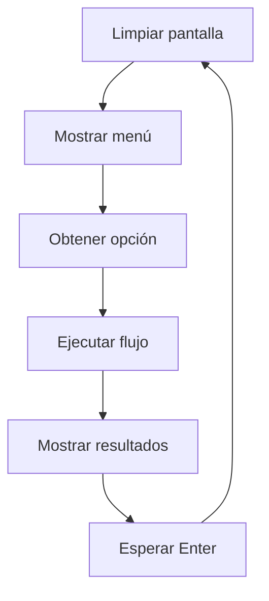
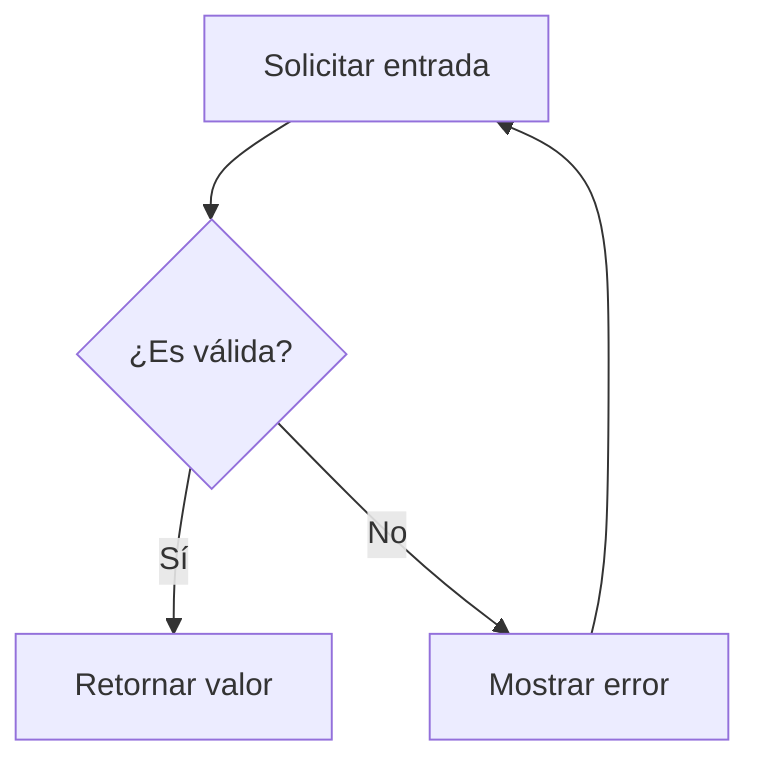
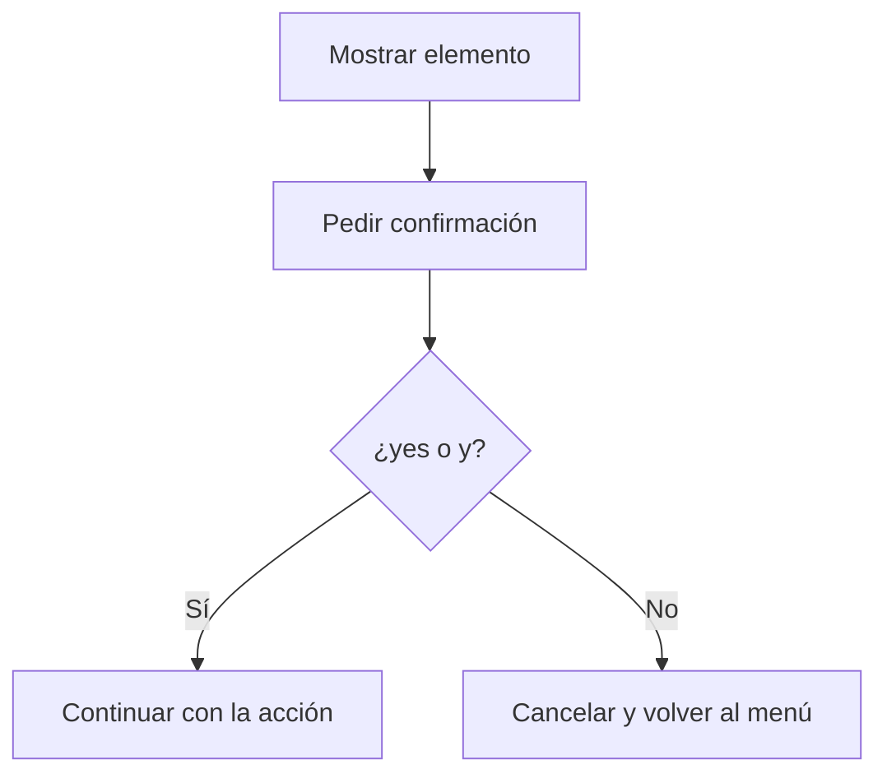

# Documentación de Frontend

## 1. Resumen

El frontend del Contact Manager es una **interfaz de línea de comandos (CLI)** que proporciona una experiencia interactiva basada en menús. La capa de interfaz maneja toda la interacción del usuario y coordina los servicios con la persistencia.

Los textos de la aplicación están en inglés. Este documento los muestra tal como aparecen en pantalla.

## 2. Arquitectura de Interfaz

**Ubicación**:
- `app/interface/menu.py`: Menú, solicitudes de entrada y mensajes
- `app/interface/contact_flows.py`: Flujo interactivo de cada opción del menú

**Tipo**: Interfaz de terminal basada en texto

**Estilo**: Basado en menú con opciones numeradas

**Modelo de Interacción**: Solicitud-respuesta síncrona

## 3. Menú Principal

### 3.1 Diseño del Menú

Ver: [wireframes/main_menu.txt](wireframes/main_menu.txt)

```
==================================================
                 CONTACT MANAGER
==================================================
1. Add contact
2. View all contacts
3. Search contacts
4. Update contact
5. Delete contact
6. Export to CSV
7. Exit
==================================================

Select option (1-7): _
```

**Especificaciones del Menú**:
- Ancho: 50 caracteres (configurable vía `MENU_WIDTH`)
- Borde: Caracteres `=`
- Título: Centrado usando método `.center()`
- Opciones: Numeradas 1-7

### 3.2 Comportamiento del Menú

**Al Entrar**:
1. La pantalla se limpia usando códigos de escape ANSI
2. El menú se muestra
3. El cursor espera en el mensaje de opción

**Al Seleccionar**:
1. El usuario ingresa un número (1-7)
2. Si es 7: salir de la aplicación
3. Si es inválida: mostrar error, esperar Enter, volver a mostrar menú
4. Si es válida: ejecutar el flujo correspondiente

**Al Completar Acción**:
1. Mostrar resultados de la operación
2. Esperar que el usuario presione Enter
3. Volver al menú (limpiado y redibujado)

## 4. Estados de Pantalla

### 4.1 Pantalla de Bienvenida

**Mostrada**: Sobre el primer menú, después de limpiar la pantalla, para que se pueda leer.

```
Welcome to Contact Manager!

[Aparece el menú principal]
```

### 4.2 Advertencia al Iniciar

**Mostrada**: Antes del primer menú si el archivo estaba dañado. Espera Enter para que la limpieza de pantalla no la borre.

```
Warning: contacts.json is damaged and was not loaded. It was kept as
contacts.json.corrupt-20260131-103000. Starting with an empty list.

Press Enter to continue...
```

### 4.3 Agregar Contacto

```
--- ADD NEW CONTACT ---
Name: John Doe
Phone (digits only, optional): 1234567890
Email (optional): john@example.com

Contact 'John Doe' added successfully!

Press Enter to continue...
```

**Mensajes de Validación**:
- Nombre vacío: "Error: Name cannot be empty." → volver al menú
- Teléfono inválido: "Error: Phone must contain digits only (0-9)." → volver a solicitar
- Email inválido: "Error: Email must have the form name@domain.com." → volver a solicitar

**Duplicado**:
```
Warning: This phone or email is already used by:

[1] John Doe
    Phone: 1234567890
    Email: john@example.com

Save anyway? (yes/no): _
```

### 4.4 Ver Todos los Contactos

```
--- ALL CONTACTS ---

[1] John Doe
    Phone: 1234567890
    Email: john@example.com

[2] Jane Smith
    Phone: Not provided
    Email: jane@example.com

Press Enter to continue...
```

**Estado Vacío**: "No contacts found."

### 4.5 Buscar Contactos

```
--- SEARCH CONTACTS ---
Search by ID, name, phone or email: jo

[1] John Doe
    Phone: 1234567890
    Email: john@example.com

Press Enter to continue...
```

**Sin Coincidencias**: "No contacts match 'zzz'."

**Búsqueda Vacía**: "Error: Search text cannot be empty."

**Lista Vacía**: "No contacts available."

### 4.6 Actualizar Contacto

```
--- UPDATE CONTACT ---
Enter contact ID: 1

Current information:

ID: 1
Name: John Doe
Phone: 1234567890
Email: john@example.com
--------------------------------------------------

Enter new values (press Enter to keep current, '-' to clear phone or email):
Name: John Smith
Phone (digits only): 9876543210
Email: -

Contact updated successfully!

Press Enter to continue...
```

**Sin Cambios**: Si todas las respuestas están vacías, muestra "No changes made." y no guarda.

### 4.7 Eliminar Contacto

```
--- DELETE CONTACT ---
Enter contact ID: 1

Contact to delete:

ID: 1
Name: John Doe
Phone: 1234567890
Email: john@example.com
--------------------------------------------------
Are you sure? (yes/no): _
```

**Confirmada**: "Contact 'John Doe' deleted."

**Cancelada**: "Deletion cancelled."

### 4.8 Exportar a CSV

```
--- EXPORT TO CSV ---

3 contact(s) exported to /ruta/del/proyecto/contacts_export.csv

Press Enter to continue...
```

### 4.9 Pantalla de Salida

```
Thank you for using Contact Manager!
```

**Comportamiento**: La aplicación termina después de este mensaje. También aparece con Ctrl+C o al terminar la entrada estándar.

### 4.10 Opción Inválida

```
Invalid option. Please select 1-7.

Press Enter to continue...
```

## 5. Funciones de Entrada

Todas están en `app/interface/menu.py`.

### 5.1 Entrada de Cadena

**Función**: `prompt_string(message)`

**Comportamiento**: Retorna la cadena sin espacios en los extremos (puede estar vacía).

### 5.2 Entrada de ID

**Función**: `prompt_contact_id(message)`

**Comportamiento**: Repite hasta recibir un ID válido, usando `parse_contact_id()`. En una entrada inválida muestra "Error: Please enter a positive whole number."

### 5.3 Entrada de Confirmación

**Función**: `prompt_confirmation(message)`

**Retorna**: `True` si la respuesta es "yes" o "y" (insensible a mayúsculas).

### 5.4 Entrada de Campo Opcional

**Función**: `prompt_optional_field(message, is_valid, error_message, allow_clear=False)`

**Uso**:
```python
phone = prompt_optional_field(
    "Phone (digits only, optional): ",
    is_valid_phone,
    INVALID_PHONE_MESSAGE,
)
```

**Comportamiento**:
- Entrada vacía o válida: la retorna
- `-` con `allow_clear=True`: lo retorna
- Otro valor: muestra el error y vuelve a solicitar

## 6. Funciones de Salida

- `print_message(message)`: Muestra información
- `print_error(message)`: Muestra `Error: {message}`
- `wait_for_enter()`: Muestra "Press Enter to continue..." y espera

## 7. Gestión de Pantalla

### 7.1 Limpiar Pantalla

**Función**: `clear_screen()`

**Ubicación**: `app/utils/console.py`

**Implementación**: Códigos de escape ANSI `\033[2J\033[H`

**Compatibilidad**: Funciona en la mayoría de terminales modernos.

### 7.2 Visualización de Menú

**Función**: `show_menu()`

**Diseño**:
- Borde superior (50 caracteres `=`)
- Título centrado
- Borde medio
- 7 opciones numeradas
- Borde inferior

## 8. Patrones de Interacción del Usuario

### 8.1 Flujo de Operación Estándar



### 8.2 Flujo de Validación



### 8.3 Flujo de Confirmación



## 9. Mensajes de Error

| Escenario | Mensaje |
|-----------|---------|
| Opción de menú inválida | "Invalid option. Please select 1-7." |
| ID inválido | "Error: Please enter a positive whole number." |
| Teléfono inválido | "Error: Phone must contain digits only (0-9)." |
| Email inválido | "Error: Email must have the form name@domain.com." |
| Nombre vacío | "Error: Name cannot be empty." |
| Búsqueda vacía | "Error: Search text cannot be empty." |
| Contacto no encontrado | "Contact with ID {id} not found." |
| Sin coincidencias | "No contacts match '{query}'." |
| Sin contactos (ver) | "No contacts found." |
| Sin contactos (otras opciones) | "No contacts available." |
| Fallo al guardar | "Error: Could not save your changes, so they were undone. {detalle}" |
| Fallo al exportar | "Error: Could not export contacts. {detalle}" |
| Fallo al cargar | "Error: Could not load your contacts, so the app will close. {detalle}" |

## 10. Mensajes de Éxito

| Operación | Mensaje |
|-----------|---------|
| Agregar contacto | "Contact '{name}' added successfully!" |
| Actualizar contacto | "Contact updated successfully!" |
| Eliminar contacto | "Contact '{name}' deleted." |
| Exportar | "{n} contact(s) exported to {ruta}" |

Estos mensajes aparecen solo después de un guardado o una exportación correctos.

## 11. Helpers de Formato

**Ubicación**: `app/helpers/formatters.py`

### 11.1 Formato de Contacto Individual

**Función**: `format_contact(contact)`

```
ID: 1
Name: John Doe
Phone: 1234567890
Email: john@example.com
--------------------------------------------------
```

### 11.2 Formato de Lista de Contactos

**Función**: `format_contact_list(contacts)`

```
[1] John Doe
    Phone: 1234567890
    Email: john@example.com

[2] Jane Smith
    Phone: Not provided
    Email: jane@example.com
```

## 12. Consideraciones de Accesibilidad

### 12.1 Compatibilidad con Lectores de Pantalla

- Todos los mensajes son texto claro
- Sin dependencia solo en formato visual
- Los mensajes de estado son explícitos

### 12.2 Navegación Solo con Teclado

- Todas las interacciones vía teclado
- No se requiere mouse
- Tecla Enter para confirmación
- Ctrl+C para salir en cualquier momento

### 12.3 Instrucciones Claras

- Cada mensaje explica la entrada esperada
- Los errores de validación explican qué salió mal
- Los campos opcionales están marcados como "optional"

## 13. Requisitos del Terminal

**Requisitos Mínimos**:
- Python 3.9 o superior
- Soporte de códigos de escape ANSI (limpieza de pantalla)
- Codificación UTF-8 (caracteres internacionales)
- Flujos estándar de entrada/salida

## 14. Wireframes

Ver: [wireframes/main_menu.txt](wireframes/main_menu.txt) para wireframes ASCII

## 15. Mejoras Futuras de UI (Fuera de Alcance)

- Mensajes codificados por color (éxito=verde, error=rojo)
- Visualización de lista de contactos basada en tabla
- Paginación para listas grandes de contactos
- Opciones de ordenamiento (por nombre, por ID)
